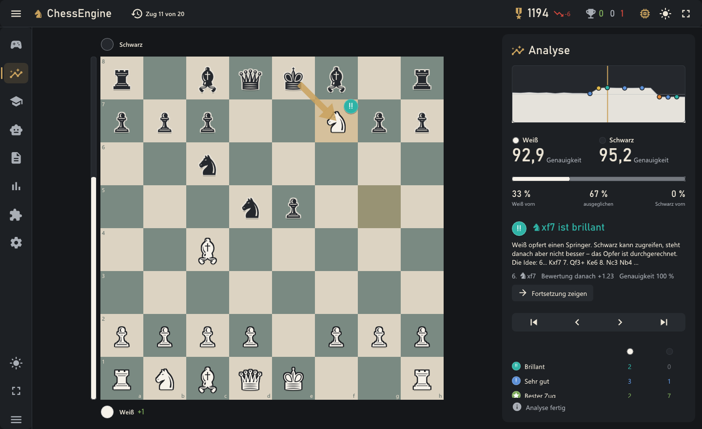
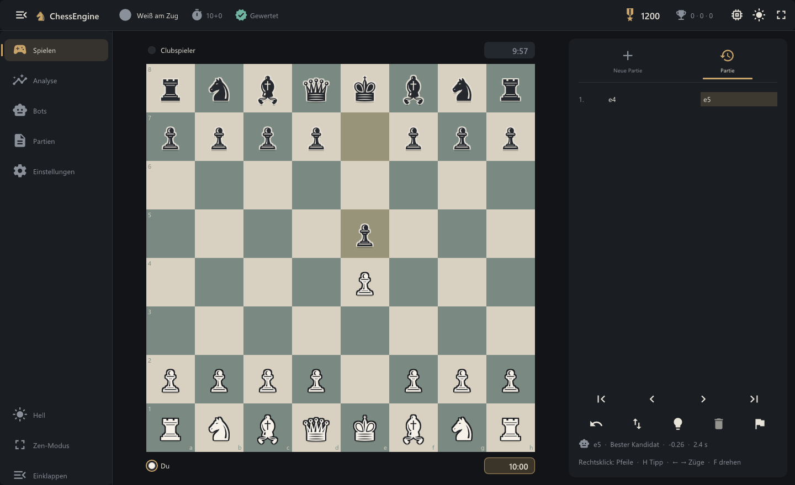
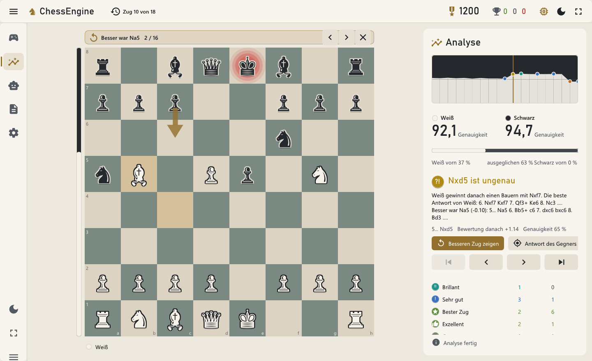
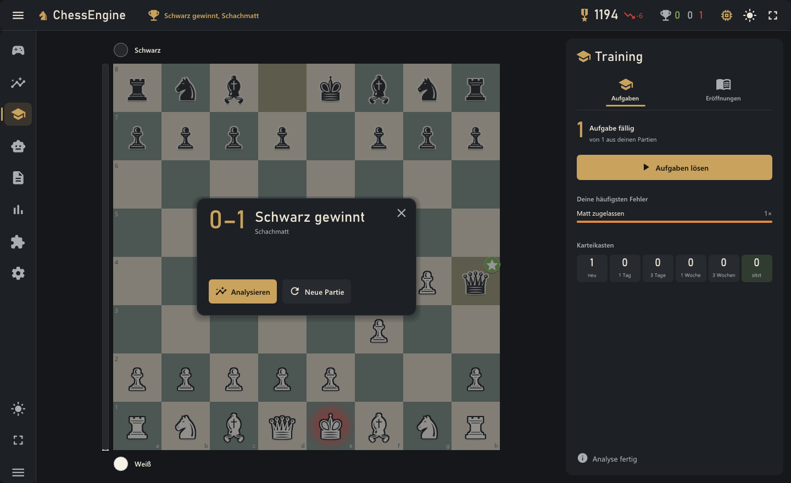
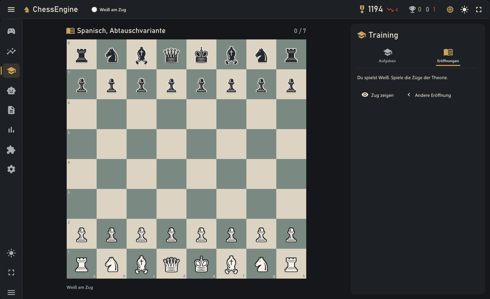
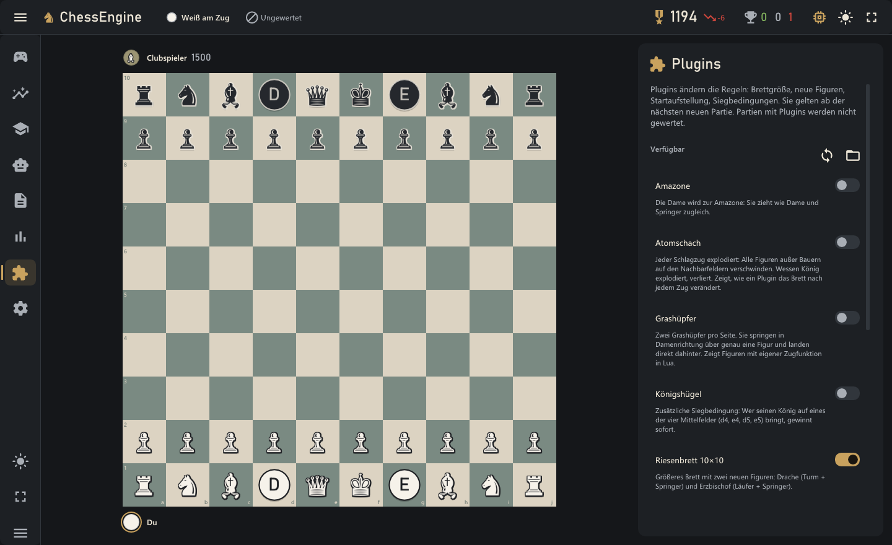
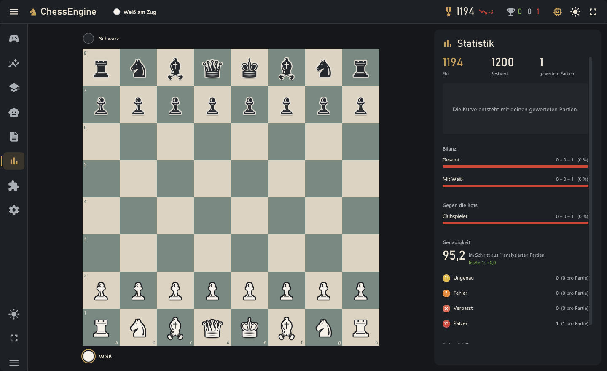

# ChessEngine

Ein Schachprogramm zum Lernen, in C++ – ohne Abo, ohne Paywall. Spiel gegen Bots mit eigener
Persönlichkeit, lass jede Partie von Stockfish auswerten und sieh Zug für Zug, was gut war, was
schiefging und was besser gewesen wäre.



## Was es kann

- **Gegen Bots spielen** – acht Bots vom Einsteiger bis zur vollen Stockfish-Stärke, mit Spielstil
  (aggressiv/vorsichtig), Zufall, Patzern und menschlicher Bedenkzeit. Alles einstellbar und als Profil
  speicherbar. Eigene Bots lassen sich direkt in der App anlegen.
- **Auf Zeit** – Bullet, Blitz, Schnellschach oder eigene Zeit mit Inkrement.
- **Partieanalyse wie bei großen Schachseiten** – Bewertungskurve, Genauigkeit, Kategorien von
  *Brillant* bis *Patzer*, eine Erklärung zu jedem Zug und die bessere Variante zum Durchspielen.
- **Hilfen zum Lernen** – mögliche Züge, gefährliche Felder, bedrohte Figuren, Tipp-Funktion, eigene
  Pfeile und Kreise. Jede Hilfe einzeln abschaltbar, bis hin zum Turniermodus ohne Hilfen.
- **Training aus eigenen Fehlern** – jeder Fehler und Patzer aus der Analyse wird zur Aufgabe
  „Finde den besseren Zug“. Wiederholung nach dem Karteikasten-Prinzip: Gelöstes kommt nach Tagen
  wieder, Falsches schon bald.
- **Eröffnungen** – gut 100 bekannte Linien mit deutschen Namen, angezeigt in Zugliste und Partienliste,
  dazu ein Eröffnungs-Trainer, in dem der Gegner nach Theorie antwortet.
- **Elo und Statistik** – lokale Wertung gegen die Bots mit Verlauf als Kurve, Bilanz mit Weiß/Schwarz
  und je Bot, Genauigkeit im Schnitt, häufigste Fehlerarten, eigene Eröffnungen.
- **Spielgefühl** – gleitende Figuren, leise Klänge, Züge vormerken (Premove), Remis anbieten,
  offene Partie beim nächsten Start fortsetzen, sechs Brett-Designs.
- **PGN-Export und -Import** – jede Partie als Text, mit Bewertungen als Kommentare; gespeicherte Partien (oder PGN aus der Zwischenablage) wieder öffnen und analysieren.
- **Lua-Plugins** – Brettgröße, neue Figuren (auch mit eigener Zugfunktion), Startaufstellung,
  Zugregeln und Siegbedingungen per Plugin ändern. Abgeschottet: kein Zugriff auf Dateien, System
  oder Netz. Neun Beispiele liegen bei, darunter Matt-in-1-Aufgaben und ein Start aus zufälligen Mittelspiel-Stellungen. Aktive Plugins werden per Ziehen sortiert – das obere gewinnt bei Konflikten, die Anleitung steht in [docs/PLUGINS.md](docs/PLUGINS.md).

| Partie gegen einen Bot | Variante durchspielen |
|---|---|
|  |  |

| Aufgaben aus eigenen Fehlern | Eröffnungs-Trainer |
|---|---|
|  |  |

| Lua-Plugins (hier: Riesenbrett 10×10) | Statistik |
|---|---|
|  |  |

## Schnellstart

Voraussetzungen: Windows 10/11, Visual Studio 2022 (C++-Workload), CMake ≥ 3.20.

```powershell
git clone <url-dieses-repositorys> chessengine
cd chessengine
cmake -S . -B build -A x64
cmake --build build --config Release
.\build\Release\chessengine_gui.exe
```

Für die volle Stärke [Stockfish herunterladen](https://stockfishchess.org/download/) und die
`stockfish*.exe` nach `engines\` im Projektordner legen (Details unten). Ohne Stockfish spielt und
analysiert die eingebaute, schwächere Engine.

Zum Weitergeben ohne Visual Studio:

```powershell
cmake --build build --config Release --target package
```

Das erzeugt `build\ChessEngine-1.0.0-win64.zip` mit Programm, Bots, Plugins und Anleitung. Wer es
entpackt, legt Stockfish nur noch in den Ordner `engines`.

Mehr zum Hintergrund: [Plan](docs/PLAN.md) · [Plugins](docs/PLUGINS.md) · [Design](docs/DESIGN.md) · [Fremde Bestandteile](THIRD_PARTY.md)

Lizenz: [MIT](LICENSE). Eingebundene Bibliotheken behalten ihre eigenen Lizenzen (siehe
[THIRD_PARTY.md](THIRD_PARTY.md)); Stockfish ist nicht enthalten.

## Stand

| Meilenstein | Status |
|---|---|
| 1. Kern (Brett W×H, Figuren als Daten, Regeln, Hooks, FEN/SAN/PGN) | ✅ fertig |
| 2. Grafische Oberfläche (SDL2 + Dear ImGui) | ✅ fertig |
| 3. Speichern & Partieliste | ✅ PGN-Dateien mit Partieliste (SQLite nicht nötig) |
| 4. Stockfish: Bots + Zuganalyse | ✅ fertig (UCI-Client, eingebaute Engine, 5 Bot-Profile, Analyse) |
| 5. Lua-Plugins | ✅ fertig (Sandbox, Spiel-API, 9 Beispiele, Plugin-Bereich mit Reihenfolge) |
| 6. Design / Zen-Modus | ✅ Grundlage fertig (Theme hell/dunkel, Zen-Modus) |

## Bauen (Windows, Visual Studio 2022)

Alle Bibliotheken liegen in `third_party/` (Dear ImGui 1.92, SDL 2.30), es muss nichts
heruntergeladen werden.

```powershell
cmake -S . -B build -G "Visual Studio 17 2022" -A x64
cmake --build build --config Release
```

Programme in `build\Release\`:

| Datei | Was |
|---|---|
| `chessengine_gui.exe` | **das Programm** mit Fenster |
| `chessengine_cli.exe` | Konsolen-Version |
| `chessengine_uci.exe` | eingebaute Engine als UCI-Programm für andere Schach-GUIs |
| `chess_tests.exe`, `chess_ui_tests.exe` | Tests |

## Oberfläche

Aufbau wie bei großen Schachseiten, aber ruhiger – und fast überall Icons (Google Material Icons)
mit Tooltips statt Text:

- **Top-Leiste** – Menü-Knopf, Logo, Status der Partie (wer ist am Zug, Bedenkzeit, *Gewertet* /
  *Ungewertet*), rechts **deine Elo** mit Trend, Bilanz (Siege · Remis · Niederlagen), Engine,
  Hell/Dunkel, Zen-Modus
- **Links: Navigation** (ein-/ausklappbar, merkt sich den Zustand) – **Spielen**, **Analyse**, **Bots**,
  **Partien**, **Einstellungen**; unten Hell/Dunkel, Zen-Modus, Einklappen
- **Mitte: Brett** mit Spielerleisten, Uhren und Bewertungsbalken
- **Rechts: Panel** zum gewählten Bereich
  - *Spielen* → Reiter **Neue Partie** (Bedenkzeit, Gegner mit geschätzter Elo, Farbe als Symbole,
    großer Start-Knopf, was ein Sieg/Remis/Niederlage an Elo bringt) und **Partie** (Zugliste,
    Icon-Leisten: Anfang/zurück/vor/Ende, Zurücknehmen, Drehen, Tipp, Markierungen löschen, Aufgeben)
  - *Analyse* – jede Stellung mit Stockfish bewerten, „besser war …“, bester Zug als Pfeil
  - *Bots* – alle Bots mit geschätzter Elo, „Gegen … spielen“, Bot anpassen
  - *Partien* – gespeicherte Partien öffnen, PGN aus der Zwischenablage, PGN kopieren/speichern, FEN
  - *Einstellungen* – alle Hilfen einzeln (siehe unten)

**Elo:** Gewertet werden Partien gegen Bots in der normalen Startstellung, ohne Zurücknehmen und ohne
Tipp (die Top-Leiste zeigt, ob die laufende Partie zählt). Formel wie bei der FIDE (K = 40 in den
ersten 30 Partien, dann 20), gespeichert in `Dokumente\ChessEngine\profil.json`. Die Stärke der Bots
ist eine Schätzung aus Stufe/Elo-Begrenzung, Patzer und Zufall.

Ziehen per Klick-Klick oder Drag & Drop. Bot und Analyse rechnen im Hintergrund, die
Oberfläche bleibt flüssig. Fertige Partien landen automatisch in `Dokumente\ChessEngine\Partien\`.

**Einstellungen (⚙):** Jede Hilfe einzeln an/aus, automatisch gespeichert in
`Dokumente\ChessEngine\einstellungen.json`. Schnellwahl: **Lernen** (alles an), **Standard**, **Ohne Hilfen**
(wie im Turnier).

| Gruppe | Schalter |
|---|---|
| Beim Ziehen | mögliche Züge (Punkte), gefährliche Zielfelder rot, Rahmen ums Zielfeld |
| Während der Partie | gefährdete eigene Figuren markieren, Schach-Schein, letzter Zug, Materialvorteil, Tipp (H), Zurücknehmen, Bewertung des Bots, eigene Pfeile & Kreise |
| Analyse | Bewertungsbalken, bester Zug als Pfeil, `?!` `?` `??` in der Zugliste |
| Darstellung | Koordinaten, dunkles Design |

„Gefährlich“ heißt: Die Figur verliert dort Material – sie ist ungedeckt angegriffen oder eine billigere
Figur kann sie schlagen (Dame vom Springer bedroht). Ein gedecktes Feld, das nur der König angreift,
gilt als sicher.

**Uhr:** Sie läuft ab dem ersten Zug, das Inkrement kommt nach jedem eigenen Zug dazu. Unter 10 Sekunden
wird sie rot und zeigt Zehntel. Zeit abgelaufen = verloren – außer der Gegner kann gar nicht mehr
mattsetzen (dann Remis). „Zurücknehmen“ stellt auch die Uhren zurück. „Aufgeben“ beendet die Partie.

**Bots wie Menschen:** Jeder Bot hat ein Tempo – *Sofort*, *Fest* oder *Wie ein Mensch*. Menschlich heißt:
die Bedenkzeit ist zufällig zwischen min und max verteilt, erzwungene Züge, Eröffnungszüge und
Rückschläge kommen schneller, komplizierte Stellungen dauern länger, und mit Uhr teilt sich der Bot
seine Zeit ein. In Zeitnot (unter 10 s) steigt seine Fehlerwahrscheinlichkeit um „Nervosität“.
Voreingestellt: Lehrling gemütlich (1,5–9 s) und nervös, Angreifer schnell und impulsiv (0,4–3 s),
Mauer lange (2–10 s), Meister ruhig, Turbo zieht sofort. Unter „Bot anpassen“ lässt sich alles
(Stärke, Stil, Zufall, Patzer, Tempo, Nervosität) live ändern und nach `Dokumente\ChessEngine\Bots`
speichern; dort gespeicherte Profile ersetzen beim Start die Vorlagen.

**Auf dem Brett:**

- Figur anklicken → mögliche Ziele erscheinen als Punkte (Schlagzüge als Ring). **Rot** heißt:
  dort verliert die Figur Material (abschaltbar unter ⚙).
- **Rechtsklick + Ziehen** zeichnet einen Pfeil, **Rechtsklick auf ein Feld** einen Kreis – zum
  Planen und Nachdenken. Farbe: ohne Taste grün, **Shift** rot, **Strg** blau, **Alt** gelb.
  Dieselbe Markierung nochmal entfernt sie; ein Linksklick oder ein Zug löscht alle.
- **Tipp (H)**: die Engine zeigt einen guten Zug als Pfeil (in voller Stärke, auch gegen einen Bot).

| Taste | Wirkung |
|---|---|
| ← → / Pos1 / Ende | Züge nachspielen |
| H | Tipp für den aktuellen Zug |
| Strg+Z | Zug zurücknehmen (gegen Bot: bis du wieder dran bist) |
| Strg+N | neue Partie |
| F | Brett drehen |
| Z | Zen-Modus (nur das Brett) |
| Esc | Auswahl aufheben |

Für Screenshots/Tests: `chessengine_gui.exe --screenshot bild.bmp [--moves "e4 e5 ..."] [--analyse]
[--bot <nr>] [--tab 0-3] [--view <halbzug>] [--marks "e2e4 d5"] [--select f3] [--hint] [--light]`

Konsolen-Version:

```powershell
.\build\Release\chessengine_cli.exe
```

Züge in SAN (`e4`, `Nf3`, `O-O`, `exd5`, `e8=Q`) oder Koordinaten (`e2e4`).
Befehle: `zuege`, `zurueck`, `bots`, `bot <nr|name> [weiss|schwarz]`, `bot aus`, `analyse [tiefe]`,
`engine [pfad]`, `pgn`, `fen`, `neu`, `hilfe`, `ende`.

## Stockfish einbinden

Stockfish ist nicht im Projekt enthalten (GPL-3, eigenes Programm). Herunterladen von
<https://stockfishchess.org/download/> und die `stockfish*.exe` an eine dieser Stellen legen:

1. Umgebungsvariable `CHESSENGINE_STOCKFISH` = Pfad zur exe
2. neben `chessengine.exe` oder in `engines\` daneben
3. in `engines\` im Projektordner (`chessengine\engines\stockfish.exe`)
4. irgendwo im `PATH` als `stockfish.exe`

Oder im Programm: `engine C:\Pfad\zu\stockfish.exe`.

Ohne Stockfish übernimmt die **eingebaute Engine** (Alpha-Beta, deutlich schwächer). Sie versteht
dafür jede Variante: andere Brettgrößen, Plugin-Figuren, eigene Regeln. Stockfish wird automatisch
nur für Standardschach benutzt.

## Bots

Jeder Bot ist eine JSON-Datei in `bots/` (wird beim Bauen neben die exe kopiert):

| Feld | Bedeutung |
|---|---|
| `name`, `description` | Anzeige |
| `engine` | `auto` (Stockfish wenn möglich), `stockfish`, `builtin` |
| `skill` | Stockfish Skill Level 0–20 |
| `elo` | > 0: Stockfish auf diese Elo begrenzen (ab ca. 1320) |
| `depth`, `movetimeMs` | Suchtiefe / Bedenkzeit pro Zug |
| `candidates` | so viele Kandidatenzüge bewertet die Engine (MultiPV) |
| `window` | Kandidaten dürfen höchstens so viele Centipawns schlechter sein als der Engine-Zug |
| `aggression` | −1 (vorsichtig) … 0 … +1 (aggressiv): bevorzugt Schläge, Schachs, Vormarsch |
| `weights` | `capture`, `check`, `advance`: wie stark diese Vorlieben wirken |
| `randomness` | Zufallsrauschen in Centipawns |
| `blunderChance` | 0–1: Wahrscheinlichkeit für einen absichtlichen Fehler (Lernmodus) |
| `pressureBlunder` | 0–1: zusätzliche Fehlerneigung, wenn weniger als 10 s auf der Uhr sind |
| `tempo` | `{ "mode": "instant" \| "fixed" \| "human", "minMs", "maxMs", "variance" }` – wie schnell der Bot zieht |

## Analyse


Nach jeder Partie (automatisch, abschaltbar) bewertet Stockfish jede Stellung mit den zwei besten
Zügen. Eingestuft wird nach dem **Verlust an Gewinnchance** (wie bei Lichess/chess.com), nicht nur in
Centipawns – ein Fehler in ausgeglichener Stellung zählt mehr als in einer längst gewonnenen.

| Symbol | Kategorie | Bedeutung |
|---|---|---|
| `!!` | Brillant | bester Zug **und** Opfer (Material geht ab, Stellung bleibt gut) |
| `!` | Sehr gut | einziger Zug, der hält – der zweitbeste ist ≥ 1,5 Bauern schlechter |
| ★ | Bester Zug | wie die Engine |
| 👍 | Exzellent | ≤ 2 % Gewinnchance verloren |
| ✓ | Gut | ≤ 5 % |
| `?!` | Ungenau | ≤ 10 % |
| `?` | Fehler | ≤ 20 % |
| ✕ | Verpasst | der Gegner hatte gerade gepatzt, die Chance blieb ungenutzt |
| `??` | Patzer | mehr als 20 % |
| → | Einziger Zug | es gab keinen anderen legalen Zug |

Der **Analyse-Bericht** zeigt die Bewertungskurve (Klick springt zur Stellung), die **Genauigkeit**
beider Spieler (Lichess-Formel), wie lange wer besser stand, die Anzahl je Kategorie und einen
**Coach** für jeden Zug: was er bewirkt, was der Gegner danach hat, was besser gewesen wäre – mit
**„Besseren Zug zeigen“** und **„Antwort des Gegners“** wird die Variante Zug für Zug auf dem Brett
vorgespielt (← → blättern, Esc zurück). Das Symbol des Zuges steht auch direkt auf dem Brett.

In der Konsole: `analyse [tiefe]`. Danach enthält `pgn` die Bewertungen als Kommentare
(`{[%eval 0.35] Ungenau – besser: Nf3}`), die Lichess und andere Tools lesen können.

`chessengine_uci.exe` ist die eingebaute Engine als UCI-Programm. Sie läuft in jeder Schach-GUI.

## Aufbau

```
src/core/
  types.hpp        Farbe, Feld, Figur, Zug, Ergebnis
  piece_type.*     Figuren als Daten (Schritte, Gleiten, Flags) + eigene Zugfunktionen
  position.*       W×H-Brett, Zuggenerierung, Angriffe, Zug ausführen/zurücknehmen
  fen.*            FEN lesen/schreiben (auch 10×10, mehrstellige Zahlen, eigene Figuren)
  notation.*       SAN und UCI-Notation
  hooks.hpp        Eingriffspunkte für Plugins (mit Priorität und Besitzer)
  game.*           Partie: Verlauf, Zurücknehmen, Hooks, Matt/Patt/Remis
  pgn.*            PGN-Export und -Import
src/util/json.*    kleiner JSON-Leser
src/engine/
  engine.hpp       gemeinsame Engine-Schnittstelle (Suche, MultiPV, Stärke)
  builtin_engine.* eingebaute Alpha-Beta-Engine (alle Varianten)
  process.*        externes Programm über stdin/stdout steuern
  uci_engine.*     UCI-Client für Stockfish & Co.
  bot.*            Bot-Profile und Zugauswahl mit Spielstil
src/analysis/      Partieanalyse, Zugklassifikation, PGN-Kommentare
src/ui/
  theme.*          Farbsystem (hell/dunkel), Schriften, ImGui-Stil
  board_view.*     Brett zeichnen, Klick/Drag & Drop, Umwandlung, Pfeile
  gui_app.*        Fenster-Inhalt: Panel, Reiter, Bot/Analyse im Hintergrund
src/app/gui_main.cpp  Fenster (SDL2) und Hauptschleife
src/app/environment.* Pfade, Stockfish-Suche, Speicherort
src/app/main.cpp   Konsolen-App (Hotseat, Bots, Analyse)
src/ui/layout.cpp  Top-Leiste, Navigation, rechtes Panel, Icon-Bausteine
src/ui/icons.hpp   benutzte Google Material Icons
src/engine/rating.* Elo-Berechnung, Bot-Stärke, Spielerprofil
assets/fonts/      Material Icons (Apache-2.0, siehe NOTICE.md)
third_party/       Dear ImGui, SDL2
src/app/uci_main.cpp  eingebaute Engine als UCI-Programm
bots/              Bot-Profile (JSON)
tests/             Perft-, Regel-, Varianten-, Engine-, Bot-, Analyse- und UCI-Tests
```

## Wie Plugins später eingreifen

Der Kern hat keine fest eingebauten Sonderregeln. Alles läuft über Daten oder Hooks:

- **Neue Figur:** `PieceType` mit Schritten (`steps::orthogonal`, `steps::knight`, …) oder einer
  eigenen Zugfunktion `customMoves` → `registry.add(...)`.
- **Brettgröße / Startaufstellung:** `hooks.onSetup` → `pos.resize(10, 10)`, `pos.place(...)`.
- **Züge verbieten oder hinzufügen:** `hooks.filterMoves`.
- **Stellung nach jedem Zug verändern:** `hooks.onMovePlayed`.
- **Eigene Sieg-/Remisbedingungen:** `hooks.checkGameEnd`.

Beispiele dafür stehen in `tests/variant_tests.cpp` (10×10-Brett, „Drache“, Teleporter,
König-des-Hügels). In Meilenstein 5 bekommt Lua genau diese Schnittstellen.
